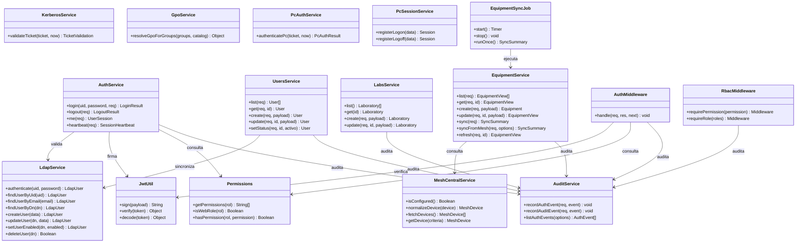
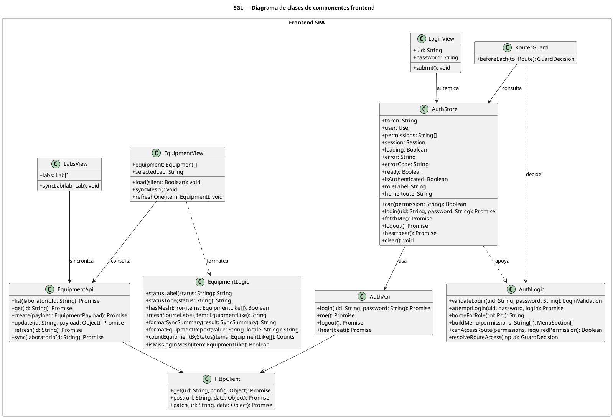
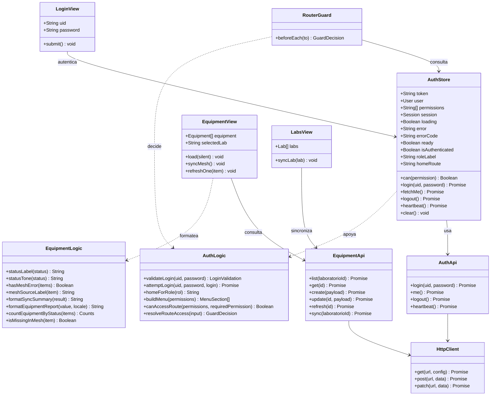

# Diagrama de clases — SGL

**Código:** SPEC-DC-01  
**Módulo/Épica:** Arquitectura y diseño del sistema  
**Alcance:** modelo de dominio, servicios backend y componentes frontend  
**Estándar:** UML 2.x · ISO/IEC 12207 (diseño de arquitectura y software)  
**Fecha:** 2026-11-08

## 1. Objetivo

Documentar la estructura estática del sistema SGL mediante diagramas de clases UML,
mostrando:

- Las entidades del dominio y sus relaciones.
- Los servicios de aplicación del backend.
- Los componentes principales del frontend.
- La correspondencia entre el modelo lógico y las tablas PostgreSQL.

El diagrama se presenta en **PlantUML** y **Mermaid** para facilitar su inclusión en
la memoria del proyecto y su regeneración automática.

## 2. Vista 1 — Modelo de dominio

### 2.1 Diagrama PlantUML

```plantuml
@startuml
title SGL — Diagrama de clases del modelo de dominio
skinparam classAttributeIconSize 0
skinparam packageStyle rectangle
hide empty methods

package "Identidad y acceso" {

  class Usuario {
    - id: UUID
    - uid: String
    - email: String
    - nombre_completo: String
    - rol: Rol
    - activo: Boolean
    - samba_sid: String
    - samba_dn: String
    - intentos_fallidos: Integer
    - bloqueado_hasta: Date
    - ultimo_login: Date
    + estaActivo(): Boolean
    + esRolWeb(): Boolean
  }

  class Grupo {
    - id: UUID
    - codigo: String
    - descripcion: String
    - samba_sid: String
    - samba_dn: String
  }

  class MembresiaGrupo {
    - id: UUID
    - fecha_asignacion: Date
    - activa: Boolean
  }

  class AsignacionDocente {
    - id: UUID
    - fecha_asignacion: Date
  }

  class SesionWeb {
    - id: UUID
    - jti: UUID
    - rol: Rol
    - ip_origen: String
    - user_agent: String
    - creada_en: Date
    - ultima_actividad: Date
    - expira_en: Date
    - revocada_en: Date
    - motivo_revocacion: String
    + estaVigente(now: Date): Boolean
  }

  class EventoAutenticacion {
    - id: UUID
    - uid_intentado: String
    - rol: Rol
    - accion: AccionEvento
    - resultado: ResultadoEvento
    - ip_origen: String
    - user_agent: String
    - detalle: JSON
    - fecha_evento: Date
  }

  class Auditoria {
    - id: UUID
    - accion: AccionAuditoria
    - entidad_afectada: String
    - entidad_id: UUID
    - detalle: JSON
    - ip_origen: String
    - fecha_evento: Date
    - inmutable: Boolean
  }

  class ArchivoAcademico {
    - id: UUID
    - nombre: String
    - tipo: String
    - tamano: Long
    - ruta_smb: String
    - created_at: Date
  }
}

package "Laboratorios y equipos" {

  class Laboratorio {
    - id: UUID
    - nombre: String
    - ubicacion: String
    - subred: String
    + contieneIp(ip: String): Boolean
  }

  class Equipo {
    - id: UUID
    - mac_address: String
    - hostname: String
    - ip_address: String
    - estado: EstadoEquipo
    - mesh_agent_id: String
    - ultimo_reporte: Date
    + estaEnLinea(): Boolean
  }

  class SesionActiva {
    - id: UUID
    - hora_inicio: Date
    - hora_fin: Date
    - activa: Boolean
  }
}

package "Aplicaciones y despliegues" {

  class Aplicacion {
    - id: UUID
    - nombre: String
    - ruta_instalador: String
    - parametros_silenciosos: String
    - version: String
    - checksum: String
  }

  class VinculoAppLab {
    - id: UUID
    - activo: Boolean
    - fecha_vinculacion: Date
  }

  class PermisoAppGrupo {
    - id: UUID
    - habilitado: Boolean
    - fecha_config: Date
  }

  class Despliegue {
    - id: UUID
    - tipo: TipoDespliegue
    - fecha_inicio: Date
    - fecha_fin: Date
    - total_equipos: Integer
  }

  class DespliegueEquipo {
    - id: UUID
    - estado: EstadoDespliegue
    - mensaje_error: String
    - intentos: Integer
    - fecha_reporte: Date
  }
}

package "Políticas y filtrado" {

  class ListaBlancaURL {
    - id: UUID
    - url: String
    - fecha_alta: Date
    - activa: Boolean
  }

  class PoliticaEjecucion {
    - id: UUID
    - reglas_applocker: String
    - gpo_xml: String
    - version: String
    - fecha_generacion: Date
  }

  class ConfigFiltrado {
    - id: UUID
    - config_squid: String
    - config_squidguard: String
    - version: String
    - fecha_generacion: Date
  }
}

enum Rol {
  ADMIN_ACADEMICO
  ADMIN_TECNICO
  DOCENTE
  ESTUDIANTE
}

enum EstadoEquipo {
  ENCENDIDO
  APAGADO
  DESCONOCIDO
}

enum AccionAuditoria {
  CREAR
  ACTUALIZAR
  ELIMINAR
  DESPLEGAR
  CAMBIO_PERMISO
  EJECUTAR
}

enum EstadoDespliegue {
  PENDIENTE
  EN_PROCESO
  COMPLETADO
  FALLIDO
}

enum TipoDespliegue {
  INSTALAR
  DESINSTALAR
}

enum ResultadoEvento {
  EXITO
  FALLO
}

enum AccionEvento {
  LOGIN
  LOGOUT
  LOGIN_FALLIDO
  LOGIN_BLOQUEADO
  ACCESO_DENEGADO
  SESION_EXPIRADA
  ROL_NO_HABILITADO
  USUARIO_INACTIVO
  AUTH_NO_DISPONIBLE
}

Usuario "1" -- "0..*" MembresiaGrupo : participa
Grupo "1" -- "0..*" MembresiaGrupo : agrupa
Usuario "1" -- "0..*" AsignacionDocente : docencia
Grupo "1" -- "0..*" AsignacionDocente : asignado

Laboratorio "1" -- "0..*" Equipo : contiene
Usuario "1" -- "0..*" SesionActiva : inicia
Equipo "1" -- "0..*" SesionActiva : registra

Usuario "1" -- "0..*" SesionWeb
Usuario "1" -- "0..*" EventoAutenticacion
Usuario "1" -- "0..*" Auditoria
Usuario "1" -- "0..*" ArchivoAcademico

Grupo "1" -- "0..*" ListaBlancaURL
Grupo "1" -- "0..*" PoliticaEjecucion
Laboratorio "1" -- "0..*" PoliticaEjecucion
Grupo "1" -- "0..*" ConfigFiltrado
Laboratorio "1" -- "0..*" ConfigFiltrado

Aplicacion "1" -- "0..*" VinculoAppLab
Laboratorio "1" -- "0..*" VinculoAppLab
VinculoAppLab "1" -- "0..*" PermisoAppGrupo
Grupo "1" -- "0..*" PermisoAppGrupo
VinculoAppLab "1" -- "0..*" Despliegue
Usuario "1" -- "0..*" Despliegue
Despliegue "1" *-- "0..*" DespliegueEquipo
Equipo "1" -- "0..*" DespliegueEquipo

Usuario ..> Rol
Equipo ..> EstadoEquipo
Auditoria ..> AccionAuditoria
Despliegue ..> TipoDespliegue
DespliegueEquipo ..> EstadoDespliegue
EventoAutenticacion ..> AccionEvento
EventoAutenticacion ..> ResultadoEvento

@enduml
```

### 2.2 Diagrama Mermaid

```mermaid
classDiagram
  class Usuario {
    +UUID id
    +String uid
    +String email
    +String nombre_completo
    +Rol rol
    +Boolean activo
    +String samba_sid
    +String samba_dn
    +Integer intentos_fallidos
    +Date bloqueado_hasta
    +Date ultimo_login
    +estaActivo() Boolean
    +esRolWeb() Boolean
  }

  class Grupo {
    +UUID id
    +String codigo
    +String descripcion
    +String samba_sid
    +String samba_dn
  }

  class MembresiaGrupo {
    +UUID id
    +Date fecha_asignacion
    +Boolean activa
  }

  class AsignacionDocente {
    +UUID id
    +Date fecha_asignacion
  }

  class Laboratorio {
    +UUID id
    +String nombre
    +String ubicacion
    +String subred
    +contieneIp(ip) Boolean
  }

  class Equipo {
    +UUID id
    +String mac_address
    +String hostname
    +String ip_address
    +EstadoEquipo estado
    +String mesh_agent_id
    +Date ultimo_reporte
    +estaEnLinea() Boolean
  }

  class SesionActiva {
    +UUID id
    +Date hora_inicio
    +Date hora_fin
    +Boolean activa
  }

  class SesionWeb {
    +UUID id
    +UUID jti
    +Rol rol
    +String ip_origen
    +String user_agent
    +Date creada_en
    +Date ultima_actividad
    +Date expira_en
    +Date revocada_en
    +String motivo_revocacion
    +estaVigente(now) Boolean
  }

  class EventoAutenticacion {
    +UUID id
    +String uid_intentado
    +Rol rol
    +AccionEvento accion
    +ResultadoEvento resultado
    +String ip_origen
    +String user_agent
    +JSON detalle
    +Date fecha_evento
  }

  class Auditoria {
    +UUID id
    +AccionAuditoria accion
    +String entidad_afectada
    +UUID entidad_id
    +JSON detalle
    +String ip_origen
    +Date fecha_evento
    +Boolean inmutable
  }

  class ArchivoAcademico {
    +UUID id
    +String nombre
    +String tipo
    +Long tamano
    +String ruta_smb
    +Date created_at
  }

  class Aplicacion {
    +UUID id
    +String nombre
    +String ruta_instalador
    +String parametros_silenciosos
    +String version
    +String checksum
  }

  class VinculoAppLab {
    +UUID id
    +Boolean activo
    +Date fecha_vinculacion
  }

  class PermisoAppGrupo {
    +UUID id
    +Boolean habilitado
    +Date fecha_config
  }

  class Despliegue {
    +UUID id
    +TipoDespliegue tipo
    +Date fecha_inicio
    +Date fecha_fin
    +Integer total_equipos
  }

  class DespliegueEquipo {
    +UUID id
    +EstadoDespliegue estado
    +String mensaje_error
    +Integer intentos
    +Date fecha_reporte
  }

  class ListaBlancaURL {
    +UUID id
    +String url
    +Date fecha_alta
    +Boolean activa
  }

  class PoliticaEjecucion {
    +UUID id
    +String reglas_applocker
    +String gpo_xml
    +String version
    +Date fecha_generacion
  }

  class ConfigFiltrado {
    +UUID id
    +String config_squid
    +String config_squidguard
    +String version
    +Date fecha_generacion
  }

  class Rol {
    <<enumeration>>
    ADMIN_ACADEMICO
    ADMIN_TECNICO
    DOCENTE
    ESTUDIANTE
  }

  class EstadoEquipo {
    <<enumeration>>
    ENCENDIDO
    APAGADO
    DESCONOCIDO
  }

  class AccionAuditoria {
    <<enumeration>>
    CREAR
    ACTUALIZAR
    ELIMINAR
    DESPLEGAR
    CAMBIO_PERMISO
    EJECUTAR
  }

  class EstadoDespliegue {
    <<enumeration>>
    PENDIENTE
    EN_PROCESO
    COMPLETADO
    FALLIDO
  }

  class TipoDespliegue {
    <<enumeration>>
    INSTALAR
    DESINSTALAR
  }

  class ResultadoEvento {
    <<enumeration>>
    EXITO
    FALLO
  }

  class AccionEvento {
    <<enumeration>>
    LOGIN
    LOGOUT
    LOGIN_FALLIDO
    LOGIN_BLOQUEADO
    ACCESO_DENEGADO
    SESION_EXPIRADA
    ROL_NO_HABILITADO
    USUARIO_INACTIVO
    AUTH_NO_DISPONIBLE
  }

  Usuario "1" -- "0..*" MembresiaGrupo : participa
  Grupo "1" -- "0..*" MembresiaGrupo : agrupa
  Usuario "1" -- "0..*" AsignacionDocente : docencia
  Grupo "1" -- "0..*" AsignacionDocente : asignado

  Laboratorio "1" -- "0..*" Equipo : contiene
  Usuario "1" -- "0..*" SesionActiva : inicia
  Equipo "1" -- "0..*" SesionActiva : registra

  Usuario "1" -- "0..*" SesionWeb
  Usuario "1" -- "0..*" EventoAutenticacion
  Usuario "1" -- "0..*" Auditoria
  Usuario "1" -- "0..*" ArchivoAcademico

  Grupo "1" -- "0..*" ListaBlancaURL
  Grupo "1" -- "0..*" PoliticaEjecucion
  Laboratorio "1" -- "0..*" PoliticaEjecucion
  Grupo "1" -- "0..*" ConfigFiltrado
  Laboratorio "1" -- "0..*" ConfigFiltrado

  Aplicacion "1" -- "0..*" VinculoAppLab
  Laboratorio "1" -- "0..*" VinculoAppLab
  VinculoAppLab "1" -- "0..*" PermisoAppGrupo
  Grupo "1" -- "0..*" PermisoAppGrupo
  VinculoAppLab "1" -- "0..*" Despliegue
  Usuario "1" -- "0..*" Despliegue
  Despliegue "1" *-- "0..*" DespliegueEquipo
  Equipo "1" -- "0..*" DespliegueEquipo

  Usuario ..> Rol
  Equipo ..> EstadoEquipo
  Auditoria ..> AccionAuditoria
  Despliegue ..> TipoDespliegue
  DespliegueEquipo ..> EstadoDespliegue
  EventoAutenticacion ..> AccionEvento
  EventoAutenticacion ..> ResultadoEvento
```

## 3. Vista 2 — Servicios backend

### 3.1 Diagrama PlantUML

```plantuml
@startuml
title SGL — Diagrama de clases de servicios backend
skinparam classAttributeIconSize 0
skinparam packageStyle rectangle
hide empty attributes

package "Autenticación y sesión" {

  class AuthService {
    +login(uid: String, password: String, req): LoginResult
    +logout(req): LogoutResult
    +me(req): UserSession
    +heartbeat(req): SessionHeartbeat
  }

  class LdapService {
    +authenticate(uid: String, password: String): LdapUser
    +findUserByUid(uid: String): LdapUser
    +findUserByEmail(email: String): LdapUser
    +findUserByDn(dn: String): LdapUser
    +createUser(data: UserData): LdapUser
    +updateUser(dn: String, data: UserData): LdapUser
    +setUserEnabled(dn: String, enabled: Boolean): LdapUser
    +deleteUser(dn: String): Boolean
    +mapLdapFailure(error: Error): Error
  }

  class JwtUtil {
    +sign(payload: Object): String
    +verify(token: String): Object
    +decode(token: String): Object
  }

  class Permissions {
    +getPermissions(rol: Rol): String[]
    +isWebRole(rol: Rol): Boolean
    +hasPermission(rol: Rol, permission: String): Boolean
  }

  class KerberosService {
    +validateTicket(ticket: Ticket, now: Date): TicketValidation
  }

  class GpoService {
    +resolveGpoForGroups(groups: String[], catalog: Object): Object
  }

  class PcAuthService {
    +authenticatePc(ticket: Ticket, now: Date): PcAuthResult
  }

  class PcSessionService {
    +registerLogon(data: LogonData): Session
    +registerLogoff(data: LogoffData): Session
  }
}

package "Usuarios" {
  class UsersService {
    +list(req): User[]
    +get(req, id: UUID): User
    +create(req, payload: UserPayload): User
    +update(req, id: UUID, payload: UserPayload): User
    +setStatus(req, id: UUID, activo: Boolean): User
  }
}

package "Laboratorios y equipos" {
  class LabsService {
    +list(): Laboratory[]
    +get(id: UUID): Laboratory
    +create(req, payload: LabPayload): Laboratory
    +update(req, id: UUID, payload: LabPayload): Laboratory
  }

  class EquipmentService {
    +list(req): EquipmentView[]
    +get(req, id: UUID): EquipmentView
    +create(req, payload: EquipmentPayload): Equipment
    +update(req, id: UUID, payload: EquipmentPayload): EquipmentView
    +sync(req): SyncSummary
    +syncFromMesh(req, options): SyncSummary
    +refresh(req, id: UUID): EquipmentView
  }

  class MeshCentralService {
    +isConfigured(): Boolean
    +normalizeDevice(device: Object): MeshDevice
    +fetchDevices(): MeshDevice[]
    +getDevice(criteria: Object): MeshDevice
  }

  class EquipmentSyncJob {
    +start(): Timer
    +stop(): void
    +runOnce(): SyncSummary
  }
}

package "Auditoría" {
  class AuditService {
    +recordAuthEvent(req, event: AuthEvent): void
    +recordAuditEvent(req, event: AuditEvent): void
    +listAuthEvents(options): AuthEvent[]
  }
}

package "Middlewares" {
  class AuthMiddleware {
    +handle(req, res, next): void
  }

  class RbacMiddleware {
    +requirePermission(permission: String): Middleware
    +requireRole(roles: String[]): Middleware
  }
}

AuthService --> LdapService : valida
AuthService --> JwtUtil : firma
AuthService --> Permissions : consulta
AuthService --> AuditService : audita
AuthService ..> Usuario
AuthService ..> SesionWeb
AuthService ..> EventoAutenticacion

AuthMiddleware --> JwtUtil : verifica
AuthMiddleware --> Permissions : consulta
AuthMiddleware --> AuditService : audita
AuthMiddleware ..> Usuario
AuthMiddleware ..> SesionWeb

RbacMiddleware --> AuditService : audita

UsersService --> LdapService : sincroniza
UsersService --> AuditService : audita
UsersService ..> Usuario

LabsService --> AuditService : audita
LabsService ..> Laboratorio

EquipmentService --> MeshCentralService : consulta
EquipmentService --> AuditService : audita
EquipmentService ..> Equipo
EquipmentService ..> Laboratorio

EquipmentSyncJob --> EquipmentService : ejecuta

AuditService ..> Auditoria
AuditService ..> EventoAutenticacion

@enduml
```

### 3.2 Diagrama Mermaid

## 4. Vista 3 — Componentes frontend

### 4.1 Diagrama PlantUML

### 4.2 Diagrama Mermaid

## 5. Correspondencia con la base de datos

| Clase UML | Tabla PostgreSQL | Observación |
|---|---|---|
| `Usuario` | `usuario` | Identidad y estado de acceso |
| `Grupo` | `grupo` | Grupos de estudiantes/docentes |
| `MembresiaGrupo` | `membresia_grupo` | N:M Usuario–Grupo |
| `AsignacionDocente` | `asignacion_docente` | Docente asignado a grupo |
| `Laboratorio` | `laboratorio` | Subred CIDR |
| `Equipo` | `equipo` | PC, MAC, IP y agente MeshCentral |
| `SesionActiva` | `sesion_activa` | Logon de estudiante en PC |
| `SesionWeb` | `sesion_web` | Sesión JWT revocable |
| `EventoAutenticacion` | `evento_autenticacion` | Auditoría append-only de acceso |
| `Auditoria` | `auditoria` | Auditoría inmutable de negocio |
| `Aplicacion` | `aplicacion` | Catálogo de software |
| `VinculoAppLab` | `vinculo_app_lab` | App asociada a laboratorio |
| `PermisoAppGrupo` | `permiso_app_grupo` | Permiso por grupo |
| `Despliegue` | `despliegue` | Orden de instalación/desinstalación |
| `DespliegueEquipo` | `despliegue_equipo` | Estado por PC |
| `ListaBlancaURL` | `lista_blanca_url` | URLs permitidas por grupo |
| `PoliticaEjecucion` | `politica_ejecucion` | AppLocker/GPO por grupo y laboratorio |
| `ConfigFiltrado` | `config_filtrado` | Squid/SquidGuard por grupo y laboratorio |
| `ArchivoAcademico` | `archivo_academico` | Archivos del usuario |

## 6. Relaciones principales

### Identidad y acceso

- Un `Usuario` puede tener muchas `MembresiaGrupo`; un `Grupo` puede tener muchos miembros.
- Un `Usuario` con rol `DOCENTE` se asigna a grupos mediante `AsignacionDocente`.
- Cada login web genera una `SesionWeb` y un `EventoAutenticacion`.
- Las acciones críticas generan un registro en `Auditoria`.
- `EventoAutenticacion` y `Auditoria` son inmutables a nivel de base de datos.

### Laboratorios y equipos

- Un `Laboratorio` contiene muchos `Equipo`.
- Cada `Equipo` pertenece obligatoriamente a un `Laboratorio` (RN-001).
- Un `Usuario` puede tener muchas `SesionActiva`; cada sesión se asocia a un `Equipo`.
- El estado del `Equipo` se sincroniza desde MeshCentral (`ENCENDIDO`, `APAGADO`, `DESCONOCIDO`).

### Aplicaciones y despliegues

- Una `Aplicacion` se vincula a un `Laboratorio` mediante `VinculoAppLab`.
- Cada vínculo puede tener permisos por `Grupo` en `PermisoAppGrupo`.
- Un `Despliegue` se genera desde un `VinculoAppLab` y se descompone en `DespliegueEquipo`.
- `DespliegueEquipo` guarda estado, intentos y error por PC.

### Políticas y filtrado

- `ListaBlancaURL` pertenece a un `Grupo`.
- `PoliticaEjecucion` y `ConfigFiltrado` relacionan `Grupo` y `Laboratorio`.

## 7. Notas de diseño

1. **Separación de capas:** el dominio no conoce Express, Vue ni MeshCentral; los servicios orquestan las dependencias.
2. **Auditoría desacoplada:** `AuditService` centraliza los eventos de autenticación y de negocio.
3. **Integración externa:** `MeshCentralService` aísla el protocolo del bridge; `LdapService` aísla LDAPS.
4. **Frontend testeable:** `AuthLogic` y `EquipmentLogic` son funciones puras, sin dependencia de Vue.
5. **Trazabilidad:** las clases del dominio se corresponden 1:1 con las tablas del esquema PostgreSQL.
6. **ISO/IEC 12207:** el diagrama documenta la arquitectura estática y sirve de base para las actividades de integración, transición y mantenimiento.
